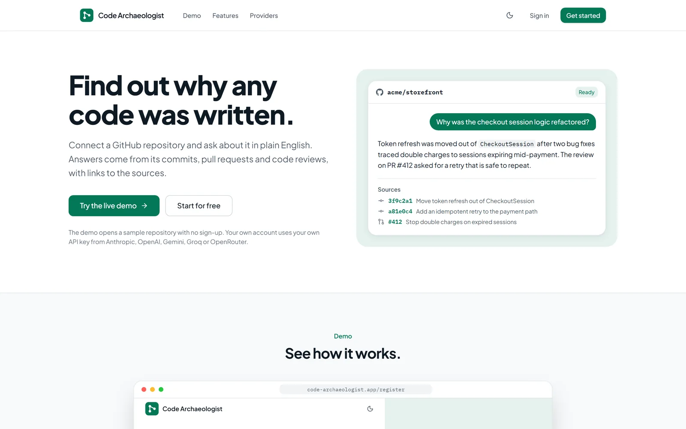
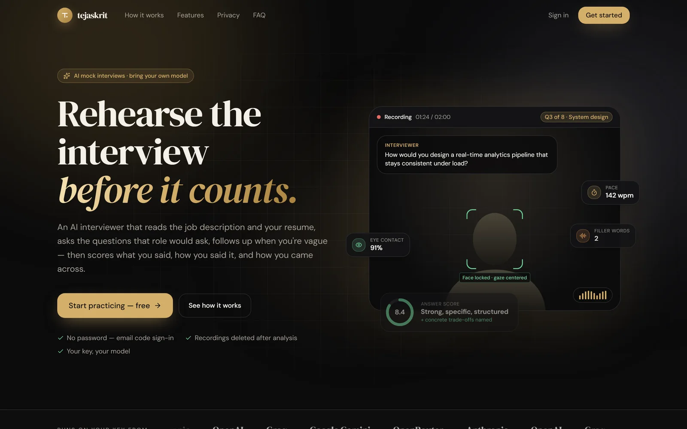
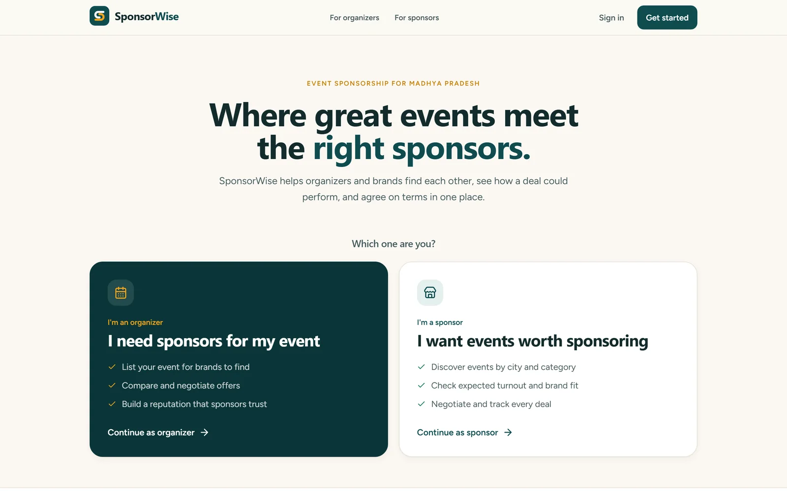
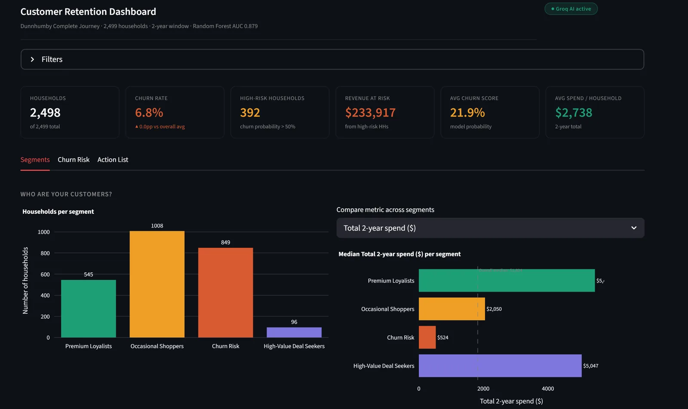

# Rishabh Patidar

**I build software that has to survive real users.**

Right now that's M91 at MSG91 (Walkover), an alerting platform with one job: keep escalating through push, SMS and voice calls until a human answers. Outside work I run two AI products of my own, on servers small enough to keep me honest.

Final-year IT student at MITS Gwalior (CGPA 8.12, graduating May 2027). Open to SDE and AI engineering roles.

[](https://rishabh.isonewho.codes)
[](https://linkedin.com/in/rishabh-ptdr)
[](https://rishabh.isonewho.codes/Rishabh_Patidar_Resume.pdf)
[](mailto:rishabhpatidar400@gmail.com)

## Things I've shipped

<table>
<tr>
<td width="50%" valign="top">
<a href="https://code-archaeologist-a9ms.onrender.com/"></a>

### Code Archaeologist

**`git blame` tells you who. This tells you why.**

Point it at a GitHub repo and ask why any code was written. Answers come only from the repo's commits, pull requests and code reviews, and cite every source.

- Hybrid search across Pinecone and BM25 finds the evidence
- Bring your own key for 5 LLM providers; new models appear the day they launch
- Fits in 512 MB by moving embeddings to a hosted model

`Python` `FastAPI` `PostgreSQL` `Pinecone` `React` `Docker`

[Live demo](https://code-archaeologist-a9ms.onrender.com/) · [Source code](https://github.com/RishabhPR77/code-archaeology-rag)

<sub>Free hosting, so the first visit can take about a minute to wake up.</sub>
</td>
<td width="50%" valign="top">
<a href="https://tejaskrit-rishabh.koreacentral.cloudapp.azure.com/"></a>

### Tejaskrit

**A mock interview that pushes back.**

Paste a job description and your resume, then answer on camera. It follows up when you're vague and scores what you said, how you said it and how you came across.

- Began as our team's SSH '26 entry (1st Runner-Up); I took it to production on Azure
- The wait between questions went from minutes to 3 or 4 seconds after splitting the work into a fast path and a background queue
- Runs on a 1 GB VM, with peak memory around 550 MB

`Python` `FastAPI` `PostgreSQL` `MediaPipe` `React` `Docker`

[Live demo](https://tejaskrit-rishabh.koreacentral.cloudapp.azure.com/) · [Source code](https://github.com/RishabhPR77/ai-interview)
</td>
</tr>
<tr>
<td width="50%" valign="top">
<a href="https://sponsorwise.vercel.app/"></a>

### SponsorWise

**Matchmaking for events and sponsors, with the odds shown up front.**

Organizers list events and brands find them. Both see predicted turnout and deal odds, then negotiate, chat and close the deal in one place.

- Two-stage XGBoost: attendance (R² 0.922 on held-out events), then whether the sponsor says yes (81% accuracy)
- An LLM scores brand fit and drafts the pitch, with fallbacks when it's unavailable
- Built with Sujal Hammad; I took it to production on Vercel, Render and MongoDB Atlas

`React` `Node.js` `MongoDB` `Socket.IO` `FastAPI` `XGBoost`

[Live demo](https://sponsorwise.vercel.app/) · [Source code](https://github.com/RishabhPR77/eventsight)

<sub>The API sleeps on free hosting, so the first prediction can take about a minute.</sub>
</td>
<td width="50%" valign="top">
<a href="https://customer-churn-dunhumby.streamlit.app/"></a>

### Churn Prediction

**Who's about to leave, and what it costs.**

Finds the households about to stop shopping across 2.5M+ transactions and puts a dollar figure on it.

- 22 RFM features and four KMeans customer segments
- Random Forest at ROC-AUC 0.879, explained with SHAP
- $233,917 of revenue at risk, shown in a Streamlit dashboard

`Python` `Scikit-learn` `XGBoost` `SHAP` `Pandas` `Streamlit`

[Live demo](https://customer-churn-dunhumby.streamlit.app/) · [Source code](https://github.com/RishabhPR77/customer-churn)
</td>
</tr>
</table>

## Smaller builds

| Project | The idea | Links |
| --- | --- | --- |
| **CinemaIQ** | Forecasts a film's box office from the pull of its actors, directors and composers | [Demo](https://movie-success-predictor-xu2vnp53g3jg8a3pmrr3k3.streamlit.app/) · [Code](https://github.com/RishabhPR77/movie-success-predictor) |
| **Video Target ID** | Follows one person across CCTV feeds by matching face and pose | [Demo](https://video-target-id-lnjmjrh3ap8jafch7wrbme.streamlit.app/) · [Code](https://github.com/RishabhPR77/video-target-id) |

<sub>The Streamlit demos sleep when idle. Click the wake-up button and give them a moment.</sub>

## Experience

```text
* Oct 2026  (HEAD) SDE Intern at MSG91 (Walkover): shipping M91 alerting
* Aug 2026  AI Engineer Intern at CogKnowEdge: built 7+ RAG systems
* Jan 2026  Research Assistant at MITS: SponsorWise ML pipeline, R² = 0.922
```

## Toolbox

[](https://skillicons.dev)

**AI and LLMs:** LangChain, LangGraph, RAG, Pinecone, Qdrant, Neo4j, OpenAI / Claude / Gemini APIs

**ML and data:** Scikit-learn, XGBoost, Pandas, NumPy, OpenCV, MediaPipe, librosa, Whisper

## Wins

- 🏆 **1st Place** (team), IKIGAI '26 National Hackathon, AITR Indore
- 🥈 **1st Runner-Up** (team Tejaskrit), SSH '26 National Hackathon
- 🏅 **Top Performer**, Web Development Track, Hacksagon, ABV-IIITM Gwalior
- 📜 **NPTEL Certification**, Mathematical Foundations of ML, IIT Madras (73/100)

---

Hiring, building something interesting, or curious about a commit? [Email me](mailto:rishabhpatidar400@gmail.com).
